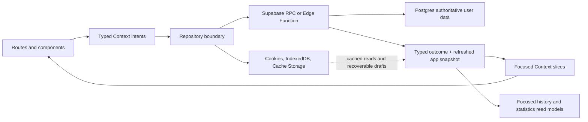

# Cali - Exercise and Meal Planner Engineering Architecture

> **Purpose:** Define the stable client, backend, security, persistence, testing, and delivery standards that every feature must follow.
>
> **Product contract:** [`FEATURES.md`](./FEATURES.md)
> **Design contract:** [`DESIGN.md`](./DESIGN.md)
> **Agent workflow:** [`AGENTS.md`](./AGENTS.md)

## MVP-3 technical handover — 2026-10-04

The MVP-3 Context/repository intents, authorized RPCs, generated types, bounded
target-date read model, step revisions, and immutable custom routine/session
snapshots are implemented. Seven forward migrations were applied to shared Cali
with authorization on 2026-10-01; all 46 history versions and 12 schema fingerprint
categories matched at that checkpoint. Preserve these applied migration files;
corrections require a new forward migration and the normal safety preflight.

Local database, repository, browser, and build evidence is dated 2026-10-01.
PR #3 merged MVP-3 into `main` on 2026-10-04; candidate and resulting-main CI
passed. CI uses a disposable database and does not repeat the shared-schema
verification. Hosted app deployment, hosted Auth configuration, staging email
delivery, final hosted acceptance, and release sign-off remain pending.
Browser tests mock external nutrition providers; local Mailpit delivery is real. Neither
establishes staging SMTP readiness. [`MVP3_HANDOVER.md`](./MVP3_HANDOVER.md)
records the remaining gates, operational constraints, and commit/file manifest;
[`MVP_Priority_Matrix.md`](./MVP_Priority_Matrix.md) retains the detailed audit.

## Architecture Baseline

The first release is a single-user, responsive web application backed by
Supabase. The architecture must provide authenticated workout planning, workout
logging, nutrition logging, grocery management, and progress review in browser
viewports from narrow mobile widths through desktop widths. The application may
be installed as a Progressive Web App (PWA), but PWA capabilities are
progressive enhancements rather than requirements for core logging or durable
writes. Supabase is the authoritative source of truth for durable user data in
the MVP. Browser storage may cache read models and preserve recoverable drafts,
but it is not a competing source of truth.

### Current auth-first boundary

The initialized scaffold requires a configured Supabase project and authenticated
identity before product routes are available. The browser/server clients,
session-refresh Proxy, PKCE callback route, auth pages, authenticated RPC
repository, RLS migrations, snapshot hydration, export, deletion, and the
atomic saved-meal logging path are implemented. Browser storage is limited to
recoverable form/session drafts and never replaces Supabase authority.
Trusted production nutrition data, protected AI extraction, and the serving/
correction boundary are implemented through Supabase Edge Functions and
forward migrations. The selected USDA release, server-side secrets, linked
migration rollout, and authenticated provider evidence are recorded in
`MVP_Priority_Matrix.md`; public deployment and production Auth configuration
remain separate launch gates.

### Client

- Next.js App Router with the selected current stable Next.js release
- React and React DOM versions supported by that Next.js release
- Strict TypeScript with `typescript`, `@types/node`, `@types/react`, and
  `@types/react-dom`
- ESLint with `eslint` and `eslint-config-next`
- Tailwind CSS with `tailwindcss`, `postcss`, and the compatible PostCSS
  integration (`@tailwindcss/postcss` for Tailwind CSS 4)
- React Context for focused UI-facing application state
- `@supabase/supabase-js` for Supabase access and `@supabase/ssr` for
  request-aware browser/server authentication clients
- `zod` for input, API response, and AI candidate validation at boundaries
- `lucide-react` for accessible web interface icons
- [`@bryllim/workout-guide`](https://www.npmjs.com/package/@bryllim/workout-guide) for framework-neutral exercise metadata and assets
- CSS transitions and Web Animations API for motion, with reduced-motion
  handling; do not add a native animation runtime
- `idb` or an equivalent small IndexedDB wrapper only if recoverable drafts or
  rebuildable read models require a typed browser persistence helper

### Optional PWA and testing packages

- Next.js built-in `src/app/manifest.ts` support for the web app manifest; this
  does not require an additional package. The manifest must define the app
  name, short name, description, `start_url`, standalone display mode, theme
  colors, and installable 192px and 512px icons.
- `@serwist/next` and `serwist` only when service-worker precaching or offline
  navigation is implemented; they must not cache unsaved authenticated
  mutations as if they were persisted
- Vitest, Testing Library, `jsdom`, and Playwright for utility, component, and
  browser-flow verification
- `web-push` only if the later web-push notification feature is implemented;
  keep it server-side and out of the browser bundle

The following native-only dependencies are not part of the Next.js client:
Expo, React Native, NativeWind, React Native Reanimated, Worklets,
`react-native-safe-area-context`, `@expo/vector-icons`, `expo-audio`,
`expo-haptics`, `expo-secure-store`, `expo-sqlite`, native cache modules,
`react-native-svg`, and native Lottie packages. Use semantic HTML, CSS,
browser storage, and web-compatible packages instead.

### Backend

Supabase is required for MVP authentication and durable data. Use the existing
technology choices:

- Supabase Auth for authenticated identity
- Supabase Postgres for durable user data
- Transactional Postgres RPCs for authoritative authenticated mutations
- RLS, explicit grants/revokes, and ownership checks for client-accessible data
- Supabase Edge Functions for AI and other integrations requiring server secrets or orchestration
- pgTAP tests for database security and domain invariants
- Generated TypeScript database contracts in `src/types/database.generated.ts`

AI requests may require a network connection, but manual workout and nutrition
drafts must be preserved across request failures. Always inspect source code,
migrations, and tests before assuming a planned or architecture statement
reflects current implementation.

### Next.js and Supabase session boundary

- Create a browser client with `createBrowserClient` for Client Components and a
  request-scoped server client with `createServerClient` for Server Components,
  Server Actions, and Route Handlers.
- Add the selected Next.js release's `proxy.ts` equivalent at the application
  boundary. Its matcher must refresh expiring Supabase cookies, propagate the
  refreshed cookies to the browser, and apply the cache headers required by
  `@supabase/ssr`.
- Use `supabase.auth.getClaims()` to authorize protected routes, reads, and
  server mutations. Use `getUser()` when a fresh server-confirmed user record
  is required. Do not use an unvalidated `getSession()` result for server-side
  authorization.
- Use the documented PKCE callback flow for browser authentication and keep
  the callback route within the authorized server boundary.
- Authenticated pages, RSC responses, Route Handlers, and Server Action
  responses must not be cached by ISR, a CDN, or a service worker. Use dynamic
  rendering and private/no-store behavior where required so session cookies and
  user data cannot cross accounts.

## Product Architecture and Runtime Data Flow

The application protects this product loop:

1. Set up a profile and goal.
2. Receive an editable weekly workout and meal plan.
3. Complete workouts and log food.
4. Review progress and adjust the next plan.

The authenticated Supabase repository is the primary MVP path. Browser storage
is a read-through cache and draft-recovery mechanism, not an offline authority.



Routes and components express user intent. They do not implement health
calculations, progression rules, nutrition totals, persistence, or durable
mutations. Repositories validate inputs, execute the authenticated Supabase
operation, and return a typed outcome with refreshed state. Browser cache and
draft recovery must never make an unsaved or stale mutation appear persisted.

## Source of Truth and Ownership Rules

| Data kind | Owner | Examples |
|-----------|-------|----------|
| User inputs and preferences | Supabase repository and Postgres | `UserProfile`, unit preference, `notificationsEnabled`, dietary pattern, equipment |
| Goals and target assumptions | Supabase repository and Postgres | `Goal`, `DailyTarget`, effective date, calculation assumptions |
| Authored catalogs | Versioned constants or trusted catalog read models | `Exercise`, trusted `Food` records |
| Planned prescriptions | Supabase repository and Postgres snapshots | `WorkoutPlan`, `PlannedWorkout`, `PlannedExercise`, `MealPlan`, `PlannedMeal` |
| Actual workout facts | Supabase repository and Postgres history | `WorkoutSession`, `ExerciseLog`, notes, RPE |
| Actual nutrition facts | Supabase repository and Postgres history | `NutritionLog`, `LoggedMeal`, serving, source, source version, confidence, date |
| User observations | Supabase repository and Postgres history | `WeightEntry` |
| Daily movement observations | Supabase repository and Postgres | `DailyStepEntry`, optional walking minutes, local date, revision |
| Custom prescriptions and actuals | Supabase repository and Postgres | Immutable `CustomWorkout` versions and separately saved `CustomWorkoutSession` snapshots |
| Grocery state | Supabase repository and Postgres list state | `GroceryList`, `GroceryItem`, checked and edited values |
| Derived domain state | Pure utilities and selectors | BMR, BMI, TDEE, totals, trends, completion status, recommendations |
| Pending AI candidates | Feature-local draft state until confirmation | Extracted foods, matches, assumptions, confidence |
| UI presentation state | Component/route or browser-local cache | Open modal, chart range, active form draft, current tab |
| Server integrations and secrets | Edge Functions or protected services | AI provider, nutrition provider, export/delete orchestration |
| Focused read models | Typed repository services | History pages, statistics, grocery data, account export |

Browser cache is not authoritative. Do not store derived state when it can be
recomputed reliably from durable facts. Do not put presentation-only state or
unconfirmed AI candidates in the durable app snapshot.

### Plan and target versioning

- `UserProfile` stores user inputs and preferences, not derived health values.
- `Goal` and `DailyTarget` retain the assumptions and effective dates used to create a target.
- Updating a target creates a new target version and does not rewrite historical summaries.
- Name and display-unit edits use the profile-only mutation path: they bump the
  profile revision without regenerating targets or plan snapshots. Body, goal,
  training, or nutrition-preference changes create only the affected future
  versions.
- `WorkoutPlan`, `PlannedWorkout`, and `PlannedExercise` represent a versioned prescription.
- Generating or editing a future plan creates a new plan version or immutable snapshot.
- Planned exercise and planned meal slots carry stable `slotKey`/order values;
  overrides and same-slot meal additions follow those identities across
  versions rather than internal row IDs.
- Accepted/rejected progression decisions retain a rule version and source
  session IDs. Applying or removing an override clones a future plan and never
  rewrites completed session snapshots.
- `WorkoutSession` and `ExerciseLog` retain the planned value shown at the time and the actual value recorded by the user.
- Nutrition records retain source, source version, assumptions, confidence, serving units, preparation basis, and date.
- Weight entries retain the original user-entered value and unit; trends do not replace observations.
- Plan regeneration must preserve explicit user substitutions and edits according to a documented merge policy.

## Client Organization

The source layout follows these responsibilities:

```text
src/
├── app/           # App Router layouts, routes, loading/error states, and route handlers
├── proxy.ts       # Supabase session refresh and request-boundary checks
├── components/    # Reusable cross-route UI and meaningful UI behavior
├── constants/     # Exercise/food catalogs, definitions, asset metadata, theme values
├── contexts/      # Focused app-state providers and hooks
├── hooks/         # Shared browser lifecycle or application hooks
├── lib/supabase/  # Browser and request-scoped server Supabase clients
├── services/      # Repositories, AI clients, caches, and domain-facing remote calls
├── styles/        # Global styles and helpers not expressible through utility classes
├── types/         # Domain, backend, generated database, and environment contracts
└── utility/       # Pure calculations, plan rules, validation, and selectors
```

Rules:

- Keep the root `src/app/layout.tsx` focused on metadata, global styles, and
  root providers. Keep route files focused on composition and data boundaries.
- Reusable visual primitives belong in `src/components/`.
- Route-specific composition remains with the route segment.
- Pure calculations and deterministic domain rules belong in `src/utility/`.
- Repository calls, storage access, cache access, AI response parsing, and remote calls belong in `src/services/`.
- Shared contracts belong in `src/types/`.
- Exercise and authored nutrition definitions belong in `src/constants/`.
- Use Server Components for server-owned reads by default and Client
  Components only where browser interactivity or client state is required.
- Use route handlers or Server Actions only as authenticated orchestration
  boundaries; authoritative durable mutations still go through authorized
  Supabase RPCs or Edge Functions.
- Create a new folder or architectural layer only when real behavior requires it.
- Do not add Redux, a second global state library, speculative routing layers, or speculative service layers alongside the existing Context/repository architecture.

## Context and State Management

- Context is the UI-facing state layer. The repository remains the authority for durable mutations and the domain utilities remain the authority for pure rules.
- Keep Context slices focused so unrelated consumers do not rerender for every state change.
- Expose intent-based actions such as `updateProfile`, `updateGoal`, `generateWorkoutPlan`, `editMealPlan`, `completeWorkout`, `saveNutritionEntry`, `updateWeight`, and `updateGroceryList`.
- Routes and components must not calculate BMR, TDEE, macros, nutrition totals, progression, trends, or completion status for persistence.
- Store durable facts such as profile inputs, target versions, plan snapshots, session records, logs, recipes, grocery edits, and weight entries.
- Derive health estimates, totals, progress, trends, and recommendations through pure helpers from durable facts.
- Use functional, immutable state updates.
- Keep active form drafts, selected chart ranges, modal visibility, and open screens out of durable domain state.
- Keep unconfirmed AI extraction results in feature-local draft state. A separate confirmed intent must create a nutrition record.
- Planned-meal editing is a versioned snapshot mutation: `editMealPlan` sends
  trusted food/meal references and expected meal-plan/grocery versions, while
  the RPC recalculates persisted nutrition metadata and returns a refreshed
  snapshot. It never rewrites completed nutrition logs.
- `addPlannedMeal` is a separate intent for a confirmed daily candidate. Its
  `add_planned_meal` RPC checks the selected week, owned eligible target,
  current plan version, and idempotency key; it can create a first weekly plan
  or copy a plan into a new version. Any newly reviewed reusable food or recipe,
  the planned row, and grocery reconciliation commit together. Eaten entries
  continue through the nutrition-save RPC and never mutate that plan version.
- Guided meal entry searches recipes through typed `searchRecipes` suggestions
  using the shared named-item ranker; recipes remain Meal records. A pure
  `recipePortion` guard resolves every ingredient and scales amounts before
  preview and grouped logging. Supplied macros bypass ingredient estimates.
  The guided editor has a stable top-level component identity so Context save
  feedback does not remount recoverable input. Its account/date/slot draft stores
  a stable recipe ID, reviewed revision/content token, servings text, fixed log
  key and planning key/reference. Resolve current snapshot contents at display
  and confirmation; stale contents require explicit renewed review. Serialize
  draft writes and retain the submitted identity before sending. Both
  `logSavedMeal` and `addPlannedMeal` accept optional fixed keys through the
  existing authorized actions. No RPC/schema/type change was made for search.
  The forward migration `20261013020142_prefer_provided_recipe_plan_nutrition.sql`
  corrects authoritative planning normalization: stored supplied macros override
  ingredient sums for new/edited prescriptions, with recipe-revision provenance
  and unknown fiber omitted. The private constraint trigger rejects unverified
  supplied macros in active carb-limited plans. Existing ownership, grants,
  plan-version checks and retries remain in force; no tables/public RPCs change.
  It does not rewrite prior prescriptions or eaten history. The authorized linked
  rollout has 70 matching migrations and 12 matching schema groups; evidence is
  recorded in SUPABASE_SETUP.md section 13. Presentation-only selection
  derives from the selected food/recipe and reports review visibility to the
  parent; it is not another durable draft field. One slot-local editor is mounted
  at a time with the existing account/date/slot draft identity. Selection hides
  search/results without discarding their state, and focus waits for the review
  or search field to mount. Close/success focus return waits for pending controls
  to re-enable. Food-review saving also disables parent entry controls, and queued
  draft writes finish before authoritative-success cleanup.
- Saved-card Add to plan uses the same authorized `addPlannedMeal` action, not
  a nutrition-save action. `SavedRecipePlanReview` resolves the current recipe
  and ingredient records, previews a positive portion with `recipePortion`, and
  requires a meal slot for the selected day. Its stable top-level component
  retains the submitted planned-row identity and retry key through failed or
  lost responses; deliberate slot/portion changes start a new intent. Stale
  recipe contents require explicit renewed review, and missing ingredients or
  planning-ineligible values cannot submit. The review is local presentation
  state, without a new recoverable draft contract; reload or cancellation ends
  that open review. Authoritative success closes it and focus return waits for
  controls to re-enable. Existing plan/grocery concurrency, eligibility and
  transaction boundaries remain unchanged. No migration or public RPC is added.
- Direct logging from a planned row uses the authenticated `log_planned_meal`
  wrapper around the existing food or grouped-meal save path. The wrapper
  checks the current owned plan version, date, slot, and reference, then stores
  the stable planned-meal app ID on the saved history record in the same
  transaction. The day view hides a planned item while any linked history
  exists; deleting the last linked log reveals it without editing the plan or
  groceries. Independent logs have no planned-meal link.
  Planned, grouped Eaten and standalone Eaten entries share a presentation-only
  `MealRow`. Planned macro pills and the Planned daily summary use stored
  prescription fields only. Missing values remain unavailable/partial rather
  than being recalculated from current references. Unresolved placeholder zeros
  are unavailable, not nutrition. Eaten pills continue reading saved logs.
  Saved meals retain recipe cards and favorite metadata; changing row layout does
  not persist or recalculate plans, recipes, groceries or eaten history.
- Saved-recipe Eaten corrections use a servings-only presentation and the existing
  authorized `update_logged_meal` endpoint. `logged_meals.recipe_servings` stores
  the actual portion, independently of recipe yield or ingredient food servings.
  Optional domain fields retain compatibility with older cached snapshots.
  The save wrapper records the portion inside the original logging transaction;
  its separate receipt prevents an original log retry from overwriting a later
  correction. A servings correction locks the owner-scoped parent, checks its
  original revision and retry intent, and scales existing child nutrition,
  quantities and estimate ranges together. IDs, sources and planned linkage stay
  intact. It never derives history from current food or recipe macros.
  Legacy recovery requires all ingredient quantities to share one recipe ratio,
  or a canonical source-provided recipe-serving snapshot. Unknown bases require
  the owner's explicit previous portion; there is no migration backfill.
  Older ingredient-editor callers retain their endpoint behavior and invalidate
  stored recipe portions after editing ingredients. Helpers and compatibility
  implementations remain private; no direct table writes or new public RPC are
  granted. The UI freezes the original snapshots/revision while editing and
  preserves both input and retry key across failed or lost-response saves.
- Saved-meal edits use `saveMeal`; when the active grocery read model is
  supplied, recipe persistence and grocery reconciliation commit in the same
  authorized transaction. `archiveMeal` soft-deletes owned recipes so
  historical planned references remain resolvable.
- Recipe authoring uses the separate typed `saveRecipe` intent and authorized
  `save_recipe` RPC. New custom/provider foods, recipe ingredients, instructions
  (`Meal.notes`), optional `Meal.reference`/`Meal.totalTimeMinutes`, manual `Meal.complexity`, and grocery reconciliation commit
  atomically. Ownership, expected revisions, explicit grants, and stable retry
  keys remain authoritative. Ordinary `saveMeal`/logging compatibility keeps
  instructions optional; recipe authoring requires nonblank instructions and
  trusted or user-provided nutrition. References are nullable text, with legacy
  source URLs copied by a forward migration. Drafts include units, review and
  custom input, stable ingredient/recipe IDs, base revisions, and the pending
  save key. Stale drafts require an explicit review/rebase before reapplication.
  Cooking metadata is optional on `RecipeIngredient`, separate from canonical
  `foodId`/nutrition `servings`. Ordered `meal_ingredients.cooking_measurement`
  JSON stores kind (amount/range/unmeasured), original display text, quantities,
  unit, optional/preparation notes and confirmed grams per unit. Nullable
  `meals.unmeasured_ingredients` stores cooking items without nutrition records;
  `nutrition_notes` stores assumptions separately from preparation instructions.
  Pure helpers validate metadata, use upper-range quantities and resolve only
  supported or explicitly confirmed conversions. Legacy records fall back to
  available grams/pieces. Whole-recipe quantities remain fixed when yield changes;
  source-provided per-serving macros remain independent.
  The existing private saved-meal transaction wraps its compatible implementation
  with the established lock order, owner checks, revision checks and idempotency
  claim. It validates cooking/canonical quantity agreement before commit. Unknown
  conversions and inconsistent payloads roll back the entire save. Older payloads
  preserve metadata only when ordered canonical ingredients are unchanged;
  changed ingredients clear incompatible metadata. No new public RPC or direct
  writes are granted. Snapshot, weekly reads and row-based export carry the
  fields, including permitted archived references. Authoring checks both table
  contracts so an older backend cannot silently drop measurements. Draft fields
  are optional additions, retaining older unit text and retry identity. Active
  tabs remain presentation-only and reset to Details without discarding drafts.
  A shared pure conversion resolver normalizes aliases, explicit numeric serving
  bases and recipe-specific gram weights. It derives household volume ratios
  only from an ingredient-specific density: 5 ml/tsp, 15 ml/tbsp, 240 ml/cup.
  Exact saved target factors precede derived factors. Unit changes convert lower
  and upper quantities together, retaining full precision and the same canonical
  food servings within database numeric precision. Quantity edits deliberately
  change the amount; source-provided macros remain independent.
  Optional draft-only `conversionBases` and `pendingConversion` fields retain
  reviewed alternate measures and unresolved confirmations. Pending steps do not
  alter the submitted measurement or renew its retry identity; confirmation
  creates the changed save intent. Completed conversions persist through the
  existing cooking metadata. No schema, RPC or generated-type extension is needed.
  Recipe authoring uses a shared nine-unit contract: g/kg/mg/oz/ml/tsp/tbsp/cup/piece
  (cup displays as cups; piece as piece/s). Draft preparation normalizes saved ingredients,
  provider review and recovered pending targets by measurement type. Legacy
  conversions remain readable internally, with saved factors and range bounds
  preserved. Exact volume ratios do not establish nutrition density. Unknown
  sources remain original context and require matching or confirmation, never an
  extra unit option. Completed conversions use the existing metadata transaction.
  Payload-changing restored drafts renew retry identity while preserving meal IDs
  and expected revisions; unchanged retries retain their key. Read-only overviews,
  plan snapshots, groceries and Eaten history are unaffected.
  Unit-only saves omit grocery reconciliation when the ordered food identities,
  canonical quantities at database precision and yield are unchanged. Existing
  recipe ownership/version checks still apply; the unused grocery version is
  omitted with its payload, leaving grocery rows and revisions intact.
  `refreshSnapshot({ silent: true })` suppresses refresh toasts for missing
  predefined cooking metadata while retaining typed failure feedback. Account
  identity guards prevent a completed read from replacing another account's
  snapshot. Recipe opening also ignores superseded/cancelled reads, and never
  infers personal original units from a name.
  Recipe saves check reference, total-time, and complexity columns before calling the RPC, so an
  older backend cannot silently drop authored details or pending ingredients.
  Whole-recipe time maps to nullable `meals.total_time_minutes`: nonnegative
  integers from 0 through 2147483647, independent of profile cooking preferences.
  The authorized saved-meal wrapper validates and writes time in the existing
  transaction. Omitted legacy payload fields preserve stored time; authored
  saves serialize a blank field as explicit null to clear it. Snapshot mapping
  preserves zero, duplication copies the domain field, and the existing row-based
  account export includes the column. Recoverable drafts retain time as text,
  including invalid input, and older drafts default to the saved time or blank.
  Account deletion removes owned nutrition, planned/grocery, and recipe ingredient
  references before the auth cascade deletes private foods, preserving restricted
  foreign keys without leaving account cleanup dependent on cascade ordering.
  Recipe covers map to nullable `meals.image`: `{ kind: "url", url }` or
  `{ kind: "upload", path }`. Explicit null clears the cover; omission preserves
  an older meal's image. The authenticated RPC validates ownership of an upload
  registration and object presence in the same recipe transaction. Its stable
  private path, rather than a signed URL, is persisted and exported.
  `/api/recipe-images` verifies the authenticated user and upload origin, bounds
  request size, decodes still JPEG/PNG/WebP with Sharp, strips metadata and
  re-encodes to at most 1600px WebP. A checksum and client upload UUID make retry
  registration stable; storage upload never overwrites an attached object.
  Recipe image presets reuse the existing optional `RecipeImage` union. Lunch is
  null/default; breakfast-egg-salad, snack-sandwich and dinner-curry-omelette are
  registered static asset IDs alongside the two existing catalog covers. A shared
  registry supplies parser validation and rendering. Read snapshots, weekly data,
  account export and recoverable recipe drafts retain the existing JSON contract.
  The forward migration extends only meals_image_shape and the existing private
  image validation handler; no new public RPC or client write grant is introduced.
  The preset gallery is retired; existing IDs remain valid. Image-only edits retain
  the existing grocery-basis check, preserving quantities, checked items, revisions,
  plans, supplied macros and Eaten history. Older IDs and null remain compatible.
  Recipe meal assignments use `meals.meal_slots` and typed `Meal.mealSlots` in
  authoring, personal overrides, snapshots, weekly reads, export and drafts.
  A private validator rejects unsupported or duplicate slots; explicit authoring
  requires at least one, while omitted fields from older clients preserve saved
  assignments. Original system recipes default to Lunch/Dinner. Personal legacy
  rows remain excluded from generation until assigned. A targeted data-only
  migration assigns the three user-reviewed legacy records by exact ID, owner,
  revision and recipe/ingredient equality checks. Unexpected edits abort the
  correction; already-applied assignments are a no-op. No general name classifier
  is introduced. Whole yields are constrained
  to 1–10,000; the forward migration rounds fractional definitions up, rescales
  supplied per-serving nutrition by old/new yield and advances revisions without
  rewriting whole-recipe ingredients, plans or historical nutrition.

  `weeklyMealGeneration` owns seeded allocation. Capacitated augmenting paths
  maximize recipe/slot matching; a bounded 28-slot branch-and-bound search adds
  daily carbohydrate capacity when required. Domain eligibility reuses planner
  rules. Typed exclusion codes retain domain eligibility independently of card
  presentation. Cards end at planning counters; exclusion explanations belong
  to the unused-preview results, not card content or checkbox descriptions. Cards
  and Select all may select all displayed recipes; the allocator and server
  still enforce the same capacity and restrictions. Generation drafts retain their seed, exact preview, selected revisions,
  basis and idempotency key under an account/week key. Zero version tokens mean
  no plan/list existed and remain valid in draft envelopes. Changed source data
  requires renewed review and a new intent; unchanged failed-save retries retain
  their key.

  Chicken meal-prep catalog additions share reviewed JSON definitions between
  typed constants and the forward SQL migration. Nine distinct USDA food records
  retain their FDC IDs and release/review provenance; Foundation bean values use
  Atwater Specific Factors and the existing two-decimal catalog representation,
  with original precision in the checked-in source evidence. Existing foods and
  recipes are never overwritten. The two new recipes calculate nutrition from
  ingredients, keeping quoted recipe macros only in nutrition notes. Registered
  covers extend the existing asset constraint and private authoring allowlist.
  Client and authoritative generation checks include the new raw chicken identity
  and unmeasured allergen names; unknown garnish amounts stay outside totals and
  grocery quantities. Existing time/budget classes and serving limits still apply.

  Context's typed `generateNutritionWeek` calls the repository and the authorized
  `generate_nutrition_week` RPC. The private writer locks the profile, selected
  week and recipes; validates profile/plan/grocery/recipe versions, ownership,
  eligibility, occupied slots, one-serving assignments and shared weekly yield;
  and rejects changes to existing rows. Existing plan-edit and grocery merge
  handlers perform atomic additions with authoritative nutrition. An empty week
  is created inside the same transaction. Explicit grants expose only the public
  wrapper; direct writes and private execution remain denied. Successful saves
  refresh the affected week while the main current-week snapshot stays independent.
  Recipe authoring checks the revision of its submitted grocery week, so a future
  generated grocery list cannot invalidate an otherwise current recipe editor.

  The private `recipe-covers` bucket uses authorized registration/read/removal
  helpers and Storage RLS. GET resolves an owner-scoped one-hour signed URL;
  the cover refreshes it after 45 minutes or an explicit retry. External HTTPS
  covers load directly without referrer information, avoiding a server URL proxy.
  Unreferenced registrations older than eight days are claimed under the same
  per-owner transaction lock as attachment, then removed through Storage API
  during subsequent uploads. Referenced covers, including archived recipes,
  cannot be expired. Client account-cleanup claims are prohibited.
  An auth deletion trigger atomically queues paths in private deletion jobs,
  releases this bucket's Storage ownership, and lets the existing account
  cascade commit. A failed deletion rolls back both queue and ownership changes.
  The server-only `recipe-image-cleanup` Edge Function drains up to 100 leased
  jobs per invocation via Storage API; failures retain jobs for retry after a
  ten-minute lease. No SQL deletion of Storage metadata is permitted. Its
  service-role authorization and a recurring server invocation must be configured
  and verified before uploaded covers are enabled in production.
  Recipe-image migration/type regeneration and local pgTAP/Storage checks are
  release gates. Older backends reject image saves
  with draft-preserving guidance rather than dropping the image field silently.
- Progress/history surfaces use bounded repository read models when available;
  the initial focused history query is limited to 366 days and 50/100-row
  cursors, while complete export remains a separate authoritative path.

Recipe cards use a focused `RecipeCardReadModel` instead of loading historical
usage into `AppSnapshot`. Context delegates `loadRecipeCardMetadata` and
`setRecipeFavorite` to typed repository methods. `get_recipe_card_metadata`
validates authenticated ownership and the requested local date, aggregates
`logged_meals` groups over the inclusive 30-day window, and ranks at most five
active recipes by count, latest date, then stable app ID. Counts exclude planned
prescriptions and use one grouped row independent of ingredients/servings.

Predefined recipe replacement uses a forward catalog-data migration. Retiring
the eight old system recipes preserves their rows and ingredient/food identities;
neither existing prescriptions nor saved nutrition are rewritten. The compact
snapshot includes a retired recipe only when the current plan references it;
Saved meals, selection controls and future generation exclude archived entries.
New ingredient identities preserve older source values. Creamy Lemon Chicken
uses six reviewed USDA SR Legacy ingredient records; Korean Beef Bowl adds ten
and reuses the reviewed honey identity. Household/garnish weights are explicit
assumptions. Bundled generated covers use `RecipeImage` kind `asset` with a
registered ID, resolved to a same-origin public asset. Client parsing, the image
constraint and authorized save transaction all accept only registered IDs;
arbitrary relative paths remain rejected. Personal catalog edits retain that cover
until changed/reset through existing image controls.

`recipe_catalog_preferences` owns per-account catalog hiding, its concurrency
revision, and an optional personal replacement identity. Owner-only RLS permits
reads; direct writes and private helper execution are revoked. Authorized recipe
saving atomically creates a new owned recipe and hides the catalog original.
Archival stores only the caller's preference. Both paths check catalog and
preference versions, serialize the user/recipe pair, and replay claimed intents.
Snapshot mapping projects preferences without mutating catalog rows and retains
hidden references needed by the current plan or recoverable editor. Card metadata
excludes hidden originals. Export includes preferences; auth-user cascades delete
them. The meal duplication editor workflow has been removed; previously created
copies remain ordinary saved recipes with their existing identities and history.

Nullable `meals.provided_nutrition` stores validated per-serving calories,
protein, carbohydrates and fat as explicit provided values. `mealNutrition`
prioritizes these values over ingredient estimates. Editor drafts preserve the
manual values; authoring saves distinguish omission from explicit null. Provided
recipe logging saves one labeled recipe portion through the existing grouped
logging boundary, using stored macros on the server and the existing piece-based
food unit. Actual servings scale the stored values; source, recipe revision and
reference identify their provenance. Claims replay before mutable recipe metadata
is consulted. Ingredients/groceries and historical logs retain their own values.
Planned logging claims the original intent separately from the grouped logger's
normalized ingredient payload, completes only after the plan link is stored, and
replays completed requests before checking newer plan versions. Matching linked
claims from older releases remain replayable. A changed request with a reused
key is rejected; failed requests leave neither intake nor a completed claim.
Unverified provided nutrition is ineligible for strict carbohydrate-limited plans.

`recipe_favorites` has a unique user/meal pair, desired boolean state, revision,
and timestamp. Retained false rows preserve concurrency versions after removal.
RLS permits only owner reads; explicit grants deny direct writes. The public
`set_recipe_favorite` wrapper delegates to a private authorized transaction,
validates ownership/catalog eligibility, claims a stable mutation key, locks the
user/recipe pair, compares the expected favorite revision, and returns the
authoritative read model. Retried keys replay without another revision. Favorites
do not mutate recipe revisions, plans, groceries, or historical nutrition.
Background metadata reads are deferred during a favorite write and cannot
suppress its success/error. Confirmed state updates both displays; failures retain
the prior state and retry identity until a deliberate refresh/retry. No offline
write queue is introduced. Account export includes favorites and deletion
removes them through the existing auth cascade.

`RecipeComplexity` is `easy | medium | hard`; the constrained, non-null meals
column defaults to medium. A forward migration backfills only null values,
including archived recipes, using existing revision/timestamp triggers. A private
security-invoker trigger normalizes legacy null inserts to medium and null updates
to the prior configured value. Supported choices, ownership/RLS, explicit grants,
RPC validation and idempotency remain unchanged. Authoring requires a supported
value in the client and RPC. Optional `Meal.complexity` remains compatible with old
caches. Create/Edit drafts default missing or blank values to Medium, preserve
supported selections and reject unsupported values; the default alone does not
make a blank new draft recoverable. Duplicate paths and props are removed;
obsolete duplicate draft keys are not reused and retain their seven-day expiry. Account
export includes the meals column. Forward migrations preserve older wrappers,
recipe revisions, planned values, and logged nutrition snapshots. Shared-database
deployment remains separately authorized after migration comparison and dry run.

## Repository Boundary and Supabase Authority

### MVP-3 mutation and read contracts

The compact `nutritionWeekTargets` read model retains at most seven distinct
effective target versions needed by the current Nutrition week selector. Home
and Nutrition select by local date and then version; future-effective targets
do not replace earlier estimates. Full target history remains in Postgres and
account export rather than being copied into the application snapshot.

Typed Context intents call `save_daily_steps`, `delete_daily_steps`,
`set_celebrations`, `save_custom_workout`, `start_custom_workout`, and
`save_custom_workout_session`. Public wrappers delegate to private implementations
with controlled search paths, ownership from `auth.uid()`, validation, row/advisory
locks, natural uniqueness, and idempotency receipts. Client table writes remain
revoked. Step revisions remain monotonic across deletion/recreation so older
drafts cannot overwrite a replacement entry. Server errors carry stable codes
in sanitized JSON details while preserving readable messages.

Program selection uses the authorized profile/plan bundle intent. Profiles own
the choice; each workout plan and started session retain its program snapshot.
Carb-limited meal plans snapshot their dietary restrictions, allergies, and total
carb limit. Deferred constraints recalculate every resolved day's carbohydrates
from authoritative ingredients and serving quantities and reject unsafe edits.
Historical plans and nutrition logs retain their original assumptions. USDA
catalog additions have new IDs and recorded FDC/source versions.

The custom-workout view is `security_invoker` and respects underlying owner RLS.
The main snapshot loads up to 100 current routines and 100 recent custom
sessions, daily steps for the past year, and referenced historical routine
versions. Full version/session history remains available through account export.
Custom history is shown on its dedicated route. Independent reads run together;
derived energy ranges and milestone labels are recomputed from saved facts.

Offline mutations fail immediately, retain drafts, and expose explicit retry;
they are never silently queued. Unchanged retries reuse the intent's idempotency
key. Changed drafts create a new intent, and stale edits require deliberate
reapplication to refreshed state.

The daily-step target contract is a nullable integer `profiles.daily_step_target`
mapped to optional `UserProfile.dailyStepTarget`. It is a user preference outside
plan-generation inputs, with no default, backfill, or historical target versions.
The `setDailyStepTarget` intent carries a nullable target, expected
profile revision, and idempotency key; `set_daily_step_target` returns a
refreshed snapshot with the existing `profile-updated` event. The RPC
validates 1–200,000 or null, resolves ownership from `auth.uid()`, claims the
intent, locks the profile row, checks its revision, and updates only this preference.
Execution is authenticated-only and direct table writes remain denied.
Onboarding includes the target in its atomic profile transaction. Other profile
persistence paths preserve omitted fields and clear only explicit null.
The existing profile-row account export includes the new column.

Local rollout evidence (2026-10-05): Docker virtualization is available. All 46
baseline migration versions matched the linked history, and the pre-change dry
run was up to date. Local/linked catalog comparisons matched all 1,082 objects
(columns, constraints, indexes, policies, relations, triggers, and functions,
including privileges and controlled search paths). Function bodies matched after
normalizing CRLF to LF; no semantic schema differences or history repair were
needed. Forward migration `20261005040646_daily_step_target.sql` applies on a
clean local reset. Database lint and all 529 pgTAP assertions passed, and database
types were regenerated from that local schema. Repository tests additionally
verify simultaneous target conflicts, duplicate retries, atomic onboarding,
omitted-field preservation during plan-affecting edits, and account export.
The client checks column availability before target persistence and onboarding
with a target to retain drafts on an older backend. Linked pushes require explicit
authorization; database rollout precedes the client.
After explicit owner authorization, the linked rollout on 2026-10-05 applied only
`20261005040646_daily_step_target.sql`, with no seeds or role changes. All 47
local/linked migration versions now match and the final linked dry run is up to
date. The deployed catalog matches all 1,088 objects in the tested local schema,
including function bodies, privileges, and controlled search paths. Linked type
generation confirms the new nullable profile field and RPC signatures. Deployed
checks confirm authenticated RPC execution, anonymous denial, and denied direct
profile writes. Existing account targets remain unset until their owners save one.
Security advisor review identified the expected authenticated SECURITY DEFINER
wrapper notice; the RPC retains caller ownership checks and an empty search path.
The pre-existing backend-only rate-limit table policy notice and disabled leaked
password protection setting remain outside this migration's scope.

Authenticated browser gates use a separate localhost port (3030 by default) and
dedicated `.next-browser-tests` output with development indicators disabled.
They refuse port 3000 and reuse no running server, so manual development and
hosted account data remain untouched. Activity inputs stay disabled until draft
recovery finishes, preventing a recovered draft from replacing newly typed input.

`npm run test:email:local` temporarily enables email confirmations in this
project's local stack, uses real Mailpit delivery, and restores the configuration
in `finally`. It uses only local test credentials, disables token-bearing browser
traces, and removes its disposable account. Hosted SMTP and the token-hash email
template must be verified separately before MVP-3 sign-off.

Every durable MVP feature uses the authenticated Supabase path:

1. **Client intent:** a typed Context action validates the shape needed by the screen and sends it to the repository.
2. **Supabase mutation:** the repository calls an authorized Supabase RPC or Edge Function, which validates ownership and domain rules before changing Postgres.
3. **Refreshed state:** the repository returns a typed outcome and refreshed read state; browser cache is updated only after the authoritative response.

For every new durable mutation:

- Add a typed intent to the appropriate Context action contract.
- Add a descriptive mutation ID for in-flight, retry, and error state.
- Validate IDs, ranges, units, date keys, state transitions, and payload shapes before persistence.
- Return a typed domain outcome and refreshed state.
- Update cache behavior deliberately.
- Preserve an idempotency strategy for session completion, nutrition save, plan generation, grocery regeneration, export, and deletion.
- Preserve the same idempotency and expected-version strategy for planned-meal
  edits, saved-meal saves, and recipe archive. Grocery merge logic must retain
  checked state, explicit quantity overrides, removed items, and custom items.
- Add repository and RPC parity tests for the same input sequence when more than one implementation exists.
- Define loading, error, offline, retry, and partial-completion behavior.

Notification preference updates are a profile-owned authorized mutation. The
preference is persisted but has no reminder-delivery side effect in MVP-1.
`export_account_data` is the only authoritative export read; the client treats
its response as the typed `AccountExport` contract and packages deterministic
CSV files plus the original JSON into a ZIP with `fflate`.
The contract includes user-owned food records (including USDA FDC ID, data
type, release/source version, provider revision, preparation basis, serving
options, and nutrition provenance) as `foods.csv`; shared starter catalog rows
are not copied into an account export.

The MVP must not silently discard a user input because Supabase or an optional
AI service is unavailable. Preserve the active draft, show the mutation as
unsaved, and provide retry behavior. Do not silently queue server mutations
without an explicit synchronization and conflict-resolution design.

## Durable Mutation Standard

A durable mutation must be:

- **Atomic:** related profile, target, plan, log, history, and grocery changes succeed or fail together in one authoritative transaction.
- **Authorized:** authenticated ownership is verified from `auth.uid()`, never from a trusted client user ID.
- **Validated:** units, serving quantities, exercise IDs, dates, ranges, and state transitions are checked at the mutation boundary.
- **Idempotent:** retries cannot duplicate workout sessions, nutrition entries, grocery items, exports, or deletes.
- **Concurrency-safe:** concurrent edits and regeneration cannot silently overwrite user corrections or completed history.
- **Observable:** return stable error codes and log only sanitized failure context.
- **Typed:** keep database contracts and client response contracts synchronized.

Use Postgres transactions or authorized RPCs for related authenticated writes.
Use IndexedDB transactions only for cache and draft-recovery updates. Prefer
natural unique constraints for once-only records where appropriate. Use a
client-generated idempotency key when the same valid intent can be submitted
more than once.

Mutation outcomes that drive UI feedback should expose semantic events, for
example:

```ts
type MutationOutcome = {
  snapshot: AppSnapshot;
  events: Array<
    | { type: "profile-updated" }
    | { type: "notification-preference-updated" }
    | { type: "target-updated"; targetId: string }
    | { type: "plan-generated"; planId: string }
    | { type: "plan-edited"; planId: string }
    | { type: "meal-saved"; mealId: string }
    | { type: "meal-archived"; mealId: string }
    | { type: "progression-decision-saved"; decisionId: string }
    | { type: "workout-override-removed"; planId: string }
    | { type: "workout-completed"; sessionId: string }
    | { type: "nutrition-entry-saved"; entryId: string }
    | { type: "weight-entry-added"; entryId: string }
    | { type: "grocery-list-updated"; listId: string }
  >;
};
```

The exact union should grow only as implemented behavior requires. Components
must not infer business events by comparing arbitrary snapshots.

### MVP-0 concurrency and draft contracts

- Mutable profile, saved-meal, nutrition-log, and grocery-list rows expose an
  integer `revision`. Immutable goal, target, workout-plan, and meal-plan
  snapshots continue to use their existing version numbers.
- Repository intents carry optional `ExpectedVersions`; the authenticated RPC
  preflight locks aggregates in the order idempotency, profile, goal/target,
  workout plan, meal plan, grocery list, then child record. Mismatches return a
  typed `stale_version` detail before domain rows are changed.
- The Context refreshes the authoritative snapshot after a stale result while
  keeping the user draft and retry intent. Reapplication is explicit and uses a
  new idempotency key; an unchanged transport retry reuses the original key.
- The M1.2 meal editor follows this protocol for plan and grocery versions;
  local two-client verification proves one stale writer is rejected and the
  retained edit succeeds only after an explicit refreshed-version reapply.
- `src/services/draftStore.ts` is the single versioned browser draft boundary.
  It uses IndexedDB when available, falls back to user-scoped localStorage,
  applies feature-specific lifetimes, reports storage failure without closing
  the active form, exposes account-scoped inspection, and clears drafts on
  sign-out or deletion.
- Draft keys contain the authenticated user ID and feature/draft type. The
  legacy unscoped `calicoach:session:*` namespace is never bulk-cleared during
  another account's sign-out; only account-scoped keys and the known
  user-scoped onboarding compatibility key are removed.

Automated target calculations use policy version `calicoach-health-v1`. The
eligibility outcome (`eligible`, `unsupported`, or `not_answered`) and screening
version are stored without sensitive reasons. Unsupported screening outcomes and
raw estimates below the supported calorie floor do not create automated targets.

## Supabase Security and Database Rules

Supabase is the MVP authority for authenticated identity and durable user data.
Apply these rules to every exposed user-data table and every server mutation:

- Treat migrations in `supabase/migrations/` as the schema source of truth. Avoid unreproducible dashboard-only changes.
- Enable RLS on every exposed user-data table.
- Combine `TO authenticated` with an ownership predicate such as `(select auth.uid()) = user_id`.
- Give update policies both `USING` and `WITH CHECK`; updates also require a usable select policy.
- Prefer `SECURITY INVOKER`.
- If `SECURITY DEFINER` is necessary, use an explicit empty or controlled `search_path`, resolve the caller with `auth.uid()`, fully qualify references, and expose only a deliberate authorized wrapper in a non-exposed private schema.
- Do not grant direct client writes that bypass validation for profile targets, plans, workout history, nutrition history, weight entries, grocery state, exports, or deletion workflows.
- Include explicit grants and revokes in every migration.
- Index ownership, date, status, and cursor predicates used by RLS or read models.
- Test cross-user denial, anonymous denial, invalid IDs, duplicate retries, concurrent edits, and direct-table-write denial.
- Regenerate `src/types/database.generated.ts` after schema changes.
- Keep AI and nutrition-provider credentials in server-side secret management only.
- USDA nutrition search is protected and on-demand rather than a bulk catalog
  import. `USDA_FDC_API_KEY` and `USDA_FDC_RELEASE` are Edge Function
  configuration, with the release label persisted as food provenance and the
  candidate revision formatted as `<dataType>:<fdcId>`.

Public authored exercise and nutrition catalog data may be readable without
ownership checks when it contains no user data. Custom foods, recipes, logs,
plans, profile data, and weight data remain owner-controlled.

## Supabase Migration Safety

The user has granted standing authorization for verified forward migrations to
the configured linked Supabase project after implementation. Do not request
per-deployment approval; complete the local verification, schema/history preflight,
preservation and security gates before proceeding. Before creating, repairing,
or pushing migrations:

1. Inspect `git status --short`, the migration list, and `supabase db push --dry-run`.
2. Compare local migrations with the linked schema, including columns, constraints, indexes, policies, grants, function bodies, and relevant data.
3. Prove the deployed baseline matches its migrations and any differences are exactly the verified pending changes. If that cannot be proven, stop and investigate. Do not use blind pulls, force flags, `--include-all`, or guessed repairs.
4. For proven equivalence, record the remote/local versions and evidence, repair history in an auditable order, and rerun the dry run.
5. Push only the verified pending set under the standing authorization, without another approval request. Exclude unrelated seeds, roles, Vault changes, and migrations.

Never edit, rename, delete, or reorder a migration that may already be applied.
Use a forward migration for corrections.

After a repair or push, verify matching local/remote history, an up-to-date dry
run, deployed RLS and RPC behavior, generated types, local reset behavior, and
the applicable database tests.

## Read Models and Snapshot Size

`loadNutritionWeek(weekOf)` uses authenticated security-invoker
`get_nutrition_week(date)` for one validated Monday-based local week. Its single
read includes the latest version for that week, saved planned rows, complete
seven-day logs and grouped meals, effective target versions, referenced recipes
(including permitted archives), ingredients/foods/serving options and matching
grocery state. Ownership is enforced through RLS and explicit execute grants.
It is separate from AppSnapshot's bounded recent history. The main snapshot's
meal plan and groceries select the current calendar week, not the most recently
edited historical week.

`useNutritionWeek` keys requests by account and week and ignores superseded
responses. Changing weeks hides prior data immediately; same-week refresh keeps
mounted review input while disabling edits. Read failures offer Retry and never
stand in for an empty week. `nutritionWeekSnapshot` scopes presentation and
mutation context without replacing global current-week state or making archived
references selectable. Context actions accept optional authoritative week context
for compatibility with existing callers, and historical corrections/deletions
carry the visible record's revision rather than requiring its presence among the
main snapshot's last 100 logs.

Nutrition's Planned and Eaten views share a stateless daily-summary presentation;
the existing calorie-budget utility accepts an optional planned mode, leaving
Eaten callers compatible. Planned completeness is checked per metric; incomplete
calories never produce an authoritative remaining budget. Corrections keep the
existing authorized update RPCs and do not create additional logs. Numeric input
steps must not introduce a minimum-based offset or round stored food quantities.

Week edits, additions and linked logging share an authenticated owner/week lock,
validate the selected plan and matching grocery revisions and preserve idempotent
operation receipts. An edit copies unchanged prescription rows exactly; explicit
content/portion changes alone use normalization. Stored plan dietary constraints
and target associations are inherited across versions. Only matching-week
groceries are reconciled, preserving identity, checked state and user overrides;
recipe ingredient quantities scale by planned servings divided by recipe yield.
No historical backfill or read-time durable writes occur. Public mutation entry
points remain compatible; private implementations are not directly executable
by clients. Migration rollout uses the standing authorization and still requires
the complete linked schema/history preflight and post-deployment verification.

The main app snapshot should contain only the compact state required to render
the authenticated user's current profile, active targets, current plan, and
today's summary. It should not become an unbounded transport for every
historical record.

Use focused, typed, ownership-checked read models for:

- Statistics by an explicit date range
- Paginated workout and activity history
- Nutrition history and daily summaries
- Exercise and trusted-food catalog data
- Grocery lists and grocery regeneration results
- Account export

Use cursor pagination for growing timelines. Keep predicates index-friendly
and return only fields rendered by the consumer. Calculate averages and trends
with explicit completeness rules so missing or partial nutrition days are not
silently treated as zero intake.

## Cache, Persistence, and Offline Behavior

- Supabase Postgres is the authoritative store for MVP profile, plan, workout, nutrition, grocery, weight, and progress data.
- Use `@supabase/ssr` with secure, appropriately scoped cookies for web session
  material. Do not place refresh tokens or sensitive user data in arbitrary
  browser storage.
- Use IndexedDB for rebuildable read-through data, active drafts, and
  recoverable in-progress session state only. Use Cache Storage or a service
  worker only for public static assets and explicitly safe read models.
- Cached data must never be presented as a confirmed server mutation.
- Cache keys must include the authenticated user identity so data cannot cross accounts or sessions.
- Sign-out and account changes must clear or isolate cached state before another user is shown.
- Cache corruption or version mismatch must fail safely without silently deleting authoritative server data.
- Active workout and nutrition drafts must survive request failure long enough for the user to retry or discard them explicitly.
- If Supabase is unavailable, read the last known cache when safe, disable or label unsaved mutations, and preserve user input.
- AI failure must preserve the user's input and leave manual nutrition logging available.
- Local cache/schema migrations must be versioned, tested, and recoverable.
- A service worker must never replay, queue, or present a durable mutation as
  successful without a confirmed authoritative response. Background sync is
  not part of the MVP unless idempotency and conflict resolution are designed.
- Never precache or serve authenticated HTML, RSC payloads, Route Handler
  responses, Server Action responses, or session-refresh responses through a
  shared service-worker or CDN cache. Authenticated routes must opt out of ISR
  or use private/no-store response behavior as appropriate.
- Export must include the supported user entities, original units, dates, sources, assumptions, and confidence values.
- Delete-account workflows must remove server data through an authorized
  operation and clear all cached browser data for that account.

## Date, Timezone, and Clock Rules

- Store local calendar dates for daily nutrition logs, weight entries, and plan dates as `YYYY-MM-DD` keys.
- Store durable events, workout start/finish times, and edit timestamps as ISO timestamps.
- Use one consistent local or configured timezone when assigning daily logs and calculating daily totals.
- A timezone change must not rewrite historical date keys.
- Consolidate date-key, week-period, and trend-window calculations in shared pure utilities.
- Test DST changes, timezone changes, app background/resume, device clock drift, and actions that cross midnight.
- A workout session must retain its event timestamps and the plan/date context shown when it started.
- Do not mutate or erase durable history in a generic day-rollover action. Derive current summaries from stored facts and the current date.

## UI Events and Navigation

Use one application-level coordinator for transient semantic events such as:

- Plan generated or edited
- Workout completed
- Nutrition entry saved or corrected
- Target updated
- Weight entry added
- Grocery list updated after a plan, recipe, serving, or item edit
- Export completed
- Data deletion completed
- Post-completion navigation

The coordinator owns ordering and dismissal. Presentation components emit
semantic callbacks and do not import unrelated navigation or mutation logic.
Avoid nested modal dialogs and preserve browser focus when dialogs open or
close. Before executing a follow-up action, re-evaluate it against the latest
snapshot when another mutation may have changed its validity.

Saved-recipe authoring uses the shared presentation-only Floating UI `Modal`.
The route owns the selected recipe, visibility, and originating focus target;
`RecipeEditor` owns its draft, ingredient interactions, and existing save intent.
Closing the modal leaves the editor mounted to preserve in-memory drafts in
addition to the existing recoverable browser draft. Successful saves clear that
draft before closing and releasing the editor. No modal state enters domain
snapshots, repository payloads, or database contracts. Floating UI owns focus
trapping, outside-element inertness, scroll locking, and return focus. A local
floating tree includes portaled non-modal help so child dismissal does not also
close the recipe. The modal header/footer remain visible around a scrolling
body; save failures and stale-version recovery remain inside the foreground
editor, and authoritative saving blocks dismissal.
Food pickers share the pure typed `searchFoods` utility, whose result includes
the food reference and presentation match category. It normalizes query text
without changing stored names, ranks bounded suggestions, and has no persistence
or provider effects. Fuzzy suggestions are never used for automatic AI matching.
Recipe servings controls and empty-field method prefilling use pure editor
utilities; their updates use the existing draft queue and calculation path.

The initial App Router navigation model is onboarding followed by the product
areas defined in `FEATURES.md`: Home, Workouts, Nutrition, Grocery, Progress,
and Settings. Keep navigation compact, provide usable keyboard and touch
targets, and ensure the workout logger remains usable with one hand and minimal
screen reading.

## AI and External Integrations

- Provider secrets belong in Supabase Edge Functions or another server-side
  secret manager, never in `NEXT_PUBLIC_*`.
- The Next.js browser client must call a protected application endpoint, not an
  AI or nutrition provider directly.
- The MVP-1 nutrition endpoints send only the minimum reviewed context to
  DeepSeek `deepseek-flash` after explicit user actions. Extraction returns
  schema-validated candidates, preparation, hidden-ingredient uncertainty, and
  questions. The separate estimate endpoint returns a low/base/high range only
  for explicitly selected unresolved items.
- Trusted nutrition records and deterministic application code own calculation;
  AI estimates are optional, low-confidence, visibly approximate, and cannot be
  promoted to trusted catalog provenance.
- The endpoint must return matches, assumptions, serving sizes, and confidence in a form the user can review and correct.
- AI output must remain a draft until the user confirms it through the separate
  `save_reviewed_meal` mutation, which creates the reusable recipe, grouped
  parent, and ordered historical child snapshots atomically.
- Restaurant meals, sauces, cooking oils, and mixed dishes must remain visibly uncertain and must not display false precision.
- Do not send complete profiles, full histories, credentials, or unrelated user data to the model. Send only the minimum context required for the requested extraction.
- Define request timeouts, rate limits, sanitized error logging, provider failure behavior, and data retention before enabling the integration.
- Post-MVP photo assistance uses a protected server boundary and `deepseek-flash` for visual candidates only. Require guided correction of portions and hidden ingredients before trusted calculation and explicit save. Do not persist meal images in app storage after analysis; disclose provider-side handling before launch. Photo, voice, and social-media extraction must not become implicit dependencies of MVP-1 text meal logging.
- Manual nutrition input must remain available as a recoverable draft when offline or when the AI/provider is unavailable; saving it requires a confirmed server mutation.

## Styling and Design System

- Use Tailwind CSS utility classes and shared CSS variables for normal styling.
- Keep shared colors, spacing, radii, typography, and effects in the web design
  tokens used by `src/app/globals.css` and shared component styles.
- Avoid scattered duplicate hex values and arbitrary dimensions.
- Keep narrow layouts compact, scannable, and touch-friendly while allowing
  desktop layouts to use the available space intentionally.
- Make workout controls prominent and usable during exercise without excessive
  reading or navigation.
- Use stable dimensions for timers, status labels, tab items, charts, and
  changing numeric values.
- Use semantic HTML, responsive containers, and browser scrolling instead of
  framework-specific scroll containers or safe-area components.

## Accessibility and Motion

Contextual help is presentation-only client state owned by the shared
`HelpPopover` component. Floating UI React owns collision-aware positioning,
hover/focus interactions, dismissal, portals, and non-modal focus management.
An in-page help-open event closes other open panels without adding domain state,
storage, repository calls, or a global state library. Stable IDs associate the
44px trigger with a named dialog and its expanded state. Preview opening leaves
focus unchanged; explicit activation pins and focuses help. Dismissal prevents
immediate reopening and restores focus only when appropriate. Help controls must
remain outside form labels and other interactive controls. Essential warnings,
consent, uncertainty, operational errors, and recovery actions remain visible.

- Every interactive icon has an accessibility role, concise label, disabled state, and at least a 44x44 effective touch target.
- Meaningful images have accessible descriptions; decorative images are hidden from accessibility.
- Status is never communicated with color alone.
- Charts include textual summaries and accessible values.
- Numeric timers and counters use tabular numerals.
- CSS and Web Animations effects should prefer `transform` and `opacity` over
  layout properties.
- Ambient, repeated, entering, and confirmation animations respect the system reduced-motion preference.
- Loading, empty, error, offline, permission-denied, and retry states are required feature states.

## Art, Audio, and Assets

- Keep reusable web assets in `public/` or register their metadata in
  `src/constants/` when they need typed application configuration.
- Use standard web asset URLs or imports; do not repeat native `require()` calls
  across routes.
- Use audio, vibration, and notification APIs only as optional progressive
  enhancements; they must not be required for workout or logging completion.
- Defer non-critical charts, catalog, illustration, audio, and animation assets until their surface mounts.
- Asset optimization must preserve the intended visual style and be measured against a recorded bundle baseline.

## TypeScript, Naming, and Comments

- TypeScript remains strict; avoid `any`.
- Shared domain contracts belong in `src/types/`.
- Use `import type` for type-only imports.
- Use PascalCase for React components, camelCase for values/functions, and descriptive union IDs.
- Use `.tsx` only for files containing JSX and `.ts` for TypeScript logic.
- Keep components focused and avoid unnecessary view wrappers.
- Extract shared behavior when it is reused or owns a meaningful independent responsibility.
- Prefer small pure helpers and readable names.

Comments are required for non-obvious invariants and platform constraints,
including:

- Plan versioning and planned-versus-actual history
- Idempotency and retry assumptions
- Nutrition serving and raw/cooked unit assumptions
- Timezone and local-date boundaries
- RLS or `SECURITY DEFINER` assumptions
- Browser cache, cookie, and local-storage behavior
- AI confirmation and privacy constraints
- Animation cancellation or reduced-motion behavior

Comments should explain why the constraint exists and what would break if it
were removed. Do not restate self-explanatory code.

## Next.js Dependency Rules

- Keep `next`, `react`, and `react-dom` on a version-compatible release set.
- Use `@supabase/ssr` for request-aware server/browser clients and follow the
  selected Next.js release's App Router authentication conventions.
- Use Tailwind CSS and its compatible PostCSS integration; do not reintroduce a
  native styling transform.
- Use `@serwist/next` with `serwist` only when the PWA service-worker
  requirement is actually implemented. Next.js manifest support alone does not
  require Serwist.
- Keep browser-only APIs out of Server Components and server-only secrets out
  of Client Components.
- Prefer the package manager's normal install/update workflow and preserve the
  lockfile once a project manifest exists.
- Do not use `--force` or `--legacy-peer-deps` as a routine peer-dependency fix.
- Re-test both `next dev` and a production `next build` after dependency or
  configuration changes.

## Environment and Secret Management

- The MVP requires the client-safe Supabase URL and publishable key configuration to authenticate and access authorized services.
- Local development uses `.env.local`; commit only `.env.example`.
- The canonical client variables are `NEXT_PUBLIC_SUPABASE_URL` and
  `NEXT_PUBLIC_SUPABASE_PUBLISHABLE_KEY`.
- Only publishable/client-safe values may use `NEXT_PUBLIC_*`.
- Store AI-provider, nutrition-provider, service-role, database, OAuth, push,
  and webhook secrets in Supabase Edge Functions or another server-side secret
  manager.
- Maintain separate development, staging, and production backend configuration before public launch.
- Keep OAuth redirect allow-lists explicit for the supported authentication environments.
- Deploy backward-compatible server changes before clients that require them.
- Do not log meal text, allergy details, health metrics, access tokens, or other sensitive user data unnecessarily.

## Verification Strategy

Use the narrowest relevant verification and expand it with risk:

The Next.js package scripts are available in `package.json`. Supabase-specific
checks apply when migrations and the local database workflow are added.

### Every code change

1. Run `npm run typecheck`.
2. Exercise the affected route at narrow mobile and desktop browser viewports.
3. Verify loading, error, disabled, empty, offline, and retry states where applicable.
4. Confirm text and controls do not overlap at larger font sizes.
5. Confirm keyboard navigation, focus behavior, responsive controls, and one-handed use remain usable.
6. Confirm accessibility roles, labels, touch targets, and reduced-motion behavior.

### Profile, goals, and health calculations

1. Verify metric and imperial input/output conversions.
2. Verify supported input boundaries and invalid values.
3. Verify calculation assumptions, target versions, and estimate/disclaimer copy.
4. Verify aggressive-target and unsupported-population handling.
5. Verify edits recalculate future targets without rewriting historical summaries.

### Plan generation and progression

1. Verify new-user state and deterministic output for the same inputs.
2. Verify equipment, training days, experience, and duration constraints.
3. Verify warm-up, rest, cooldown, regressions, progressions, and recovery boundaries.
4. Verify progression and regression thresholds using recorded RPE or difficulty.
5. Verify user overrides and substitutions survive regeneration.
6. Verify plan edits do not change completed history.

### Workout logging

1. Verify start, pause, resume, finish, skip, modification, substitution, and note flows.
2. Verify planned and actual values remain separate.
3. Verify duplicate completion and interrupted-session behavior.
4. Verify actual reps, holds, durations, load, and RPE are validated and retained.

### Nutrition, recipes, grocery, and AI

1. Verify manual food, custom food, saved meal, recipe, serving, correction, deletion, and duplicate-entry behavior.
2. Verify raw/cooked or other serving assumptions are visible and consistently calculated.
3. Verify estimated and user-provided values remain distinguishable.
4. Verify daily totals use the correct local date and do not treat missing data as zero.
5. Verify AI output is schema-validated, matched to trusted records, uncertain when appropriate, and confirmed before saving.
6. Verify AI/provider failure leaves manual logging available and does not lose user input.
7. Verify grocery regeneration preserves explicit edits and checked-state behavior according to the documented policy.

### Local persistence and account/data controls

1. Verify authenticated data survives browser restart and safe cache/schema migrations.
2. Verify reset-plan retains history.
3. Verify export contains the supported entities, original units, dates, sources, assumptions, and confidence values.
4. Verify account deletion removes server data through the authorized workflow and clears cached browser data.
5. Verify cache corruption, storage failure, network failure, and insufficient-permission states fail safely without silent data loss.

### Supabase changes

1. Reset/apply migrations locally.
2. Run database lint and pgTAP/RLS tests.
3. Verify cross-user and anonymous denial.
4. Regenerate database types.
5. Run TypeScript verification against generated contracts.
6. Review grants/revokes, RLS, indexes, idempotency, and migration ordering.

### Dependency or web-platform changes

1. Run `npm install` or the repository's package-manager equivalent and review the lockfile.
2. Run `npm run typecheck`, lint, and the relevant unit/component tests.
3. Run a production `next build`.
4. Verify the affected route in narrow and wide browser viewports.
5. If PWA behavior changed, verify the manifest, HTTPS/service-worker behavior,
   installability, cache invalidation, and failure behavior in a production-like
   browser session.

## Definition of Done

A feature is complete only when all applicable conditions are met:

1. Product behavior, edge cases, safety copy, uncertainty, and interaction copy are documented.
2. Supabase is the authoritative MVP path; network failures preserve drafts and never misrepresent unsaved mutations.
3. Durable mutations are atomic, authorized, validated, concurrency-safe, and retry-safe.
4. Plan versions and historical logs preserve what was prescribed and what actually happened.
5. Cache and offline behavior are explicit and never misrepresent unsynchronized data.
6. Shared behavior is implemented through focused components, utilities, repositories, and services.
7. Accessibility, reduced motion, large text, keyboard input, responsive behavior, and narrow-screen overflow are verified.
8. Pure calculations, repositories, critical component states, and the primary user flow have appropriate tests.
9. TypeScript, Next.js build checks, Supabase tests, and browser checks pass as applicable.
10. `FEATURES.md`, `ARCHITECTURE.md`, `DESIGN.md`, and `AGENTS.md` remain consistent with implemented behavior.

## Documentation Ownership

- This file owns stable client architecture, state/data ownership, security, persistence, testing, and delivery standards.
- [`FEATURES.md`](./FEATURES.md) owns product goals, feature scope, UX behavior, navigation, data-model expectations, and MVP acceptance criteria.
- [`DESIGN.md`](./DESIGN.md) owns current visual/design decisions, design tokens, UX patterns, responsive/navigation model, and auth-first setup.
- [`AGENTS.md`](./AGENTS.md) owns mandatory agent workflow, task routing, product guardrails, engineering guardrails, and verification requirements.
- Source code, tests, migrations, generated types, and deployed configuration remain the final truth for current implementation behavior.
